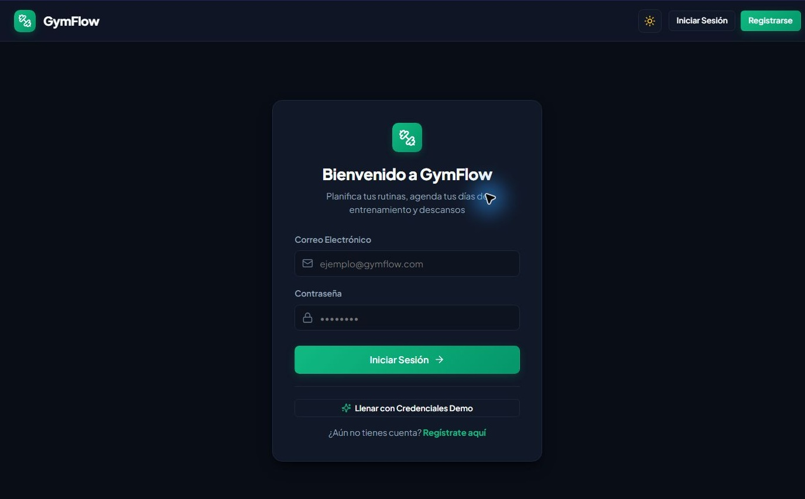
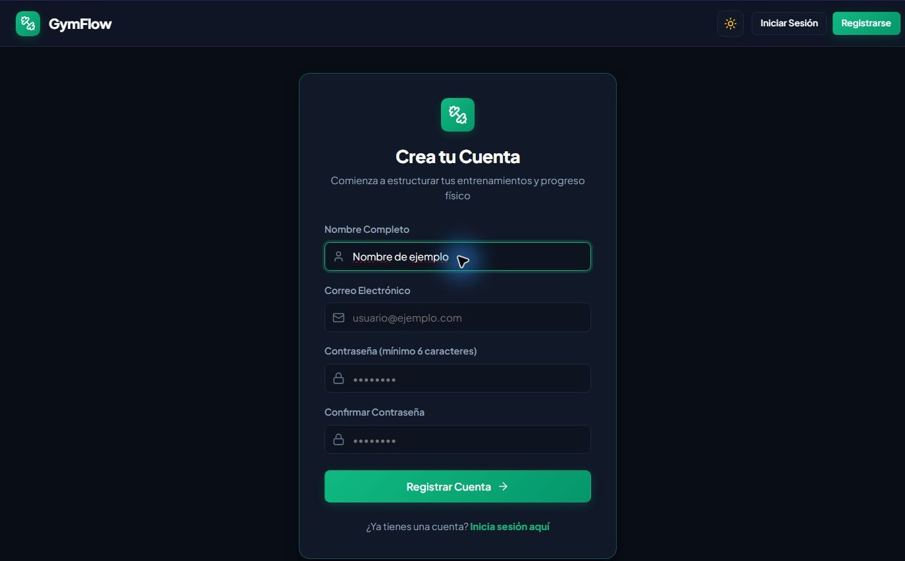
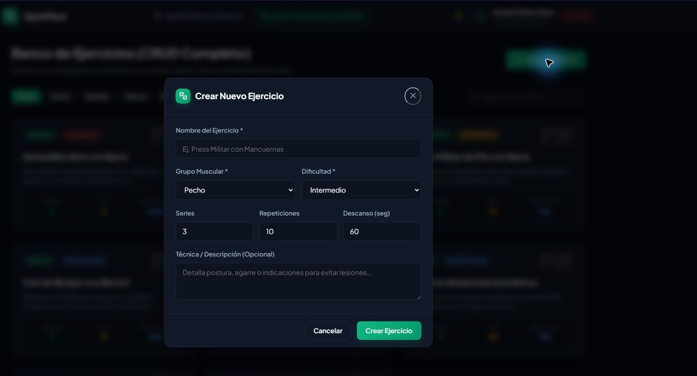
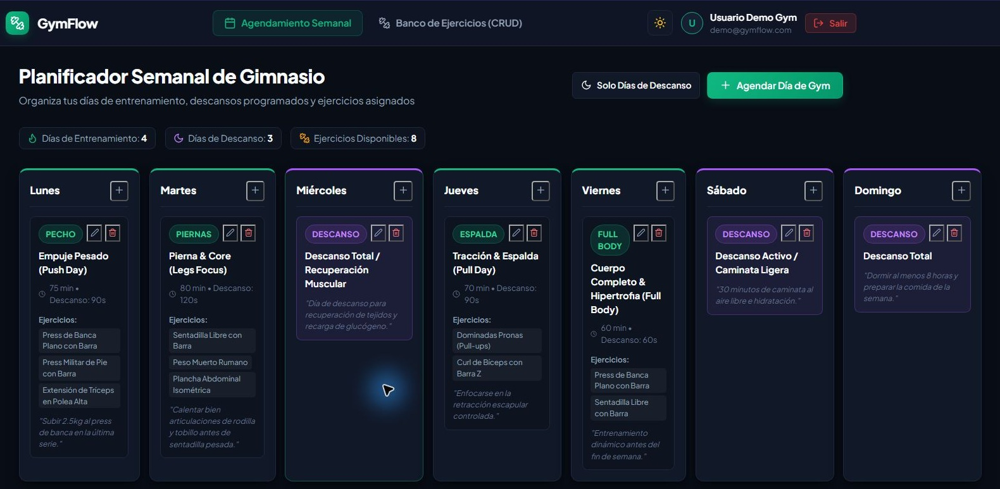
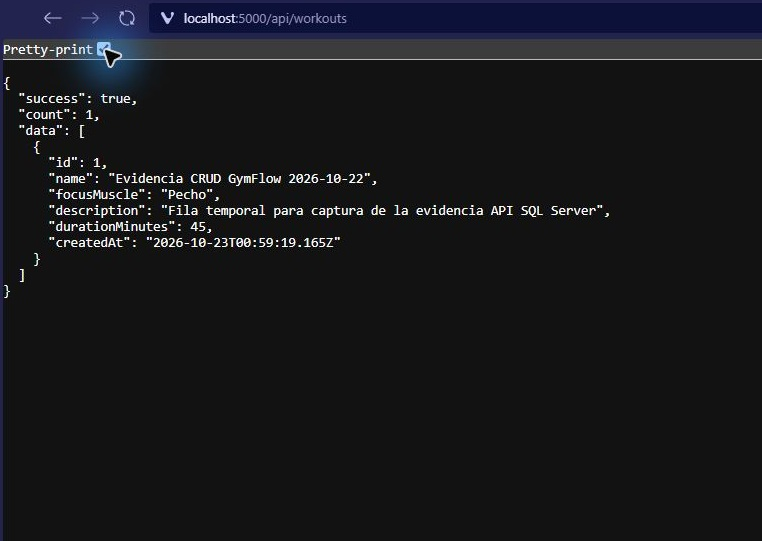

# Evidencias del entregable

Este folder reúne capturas de las vistas de GymFlow y la colección de Postman para el CRUD de rutinas guardadas en SQL Server.

## Capturas

- `01-login.jpg`: inicio de sesión.
- `02-registro.jpg`: registro de usuario.
- `03-ejercicios.jpg`: catálogo de ejercicios con formulario de creación.
- `04-agenda.jpg`: agenda semanal.
- `05-sql-server-api.jpg`: respuesta real del endpoint de rutinas conectado a SQL Server.

Las capturas se guardan aquí para adjuntarlas como evidencia junto con el enlace público al repositorio.

## Galería

### Inicio de sesión

### Registro

### Ejercicios y creación

### Agenda semanal

### Respuesta de SQL Server

## Colección Postman

Importa `GymFlow-SQL-Server.postman_collection.json` en Postman. En la colección, configura `baseUrl` (por defecto `http://localhost:8080/api`, el API Gateway). Ejecuta primero `Iniciar sesión (obtener JWT)` con una cuenta válida; la colección guarda el JWT automáticamente en `token`. Las solicitudes de escritura envían ese JWT como Bearer Token.

Orden sugerido: `Crear rutina` → `Listar rutinas` → `Obtener rutina por ID` → `Actualizar rutina` → `Eliminar rutina`. La solicitud de creación guarda automáticamente el ID de respuesta en `workoutId` para las siguientes operaciones. Para revisar el 401, elimina temporalmente el valor de `token` y vuelve a ejecutar una solicitud protegida.

El stack de Docker Compose (gateway y servicio de entrenamiento) y SQL Server deben estar activos. Este recurso se almacena en SQL Server; el catálogo de ejercicios del proyecto utiliza MongoDB/Mongoose.
